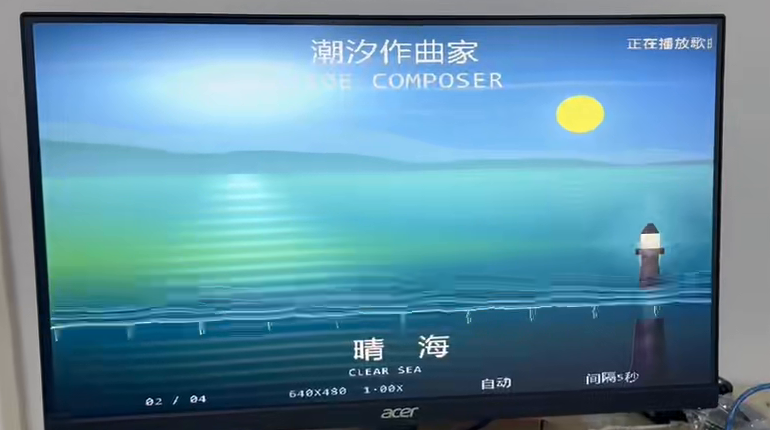
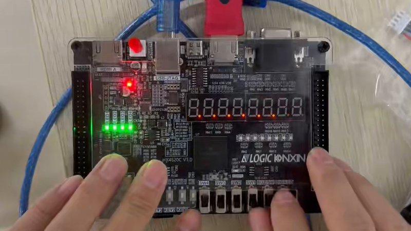

# 海洋展馆 FPGA 潮汐音画系统

基于安路 HX4S20C（EG4S20BG256）的 FPGA 多媒体展示工程。系统从 TF 卡读取四幅海岸场景图片和五首音乐，使用 SDRAM 缓存图像，通过 HDMI 输出 640×480 @ 60 Hz 的主题音画内容。

## 功能

- 四场景手动切换与自动轮播；六种转场效果。
- FPGA 板端实时 2 倍中心缩放：当前画面的中央 320×240 区域放大到 640×480，四幅图片均适用。
- HDMI 音乐播放、场景字幕、歌曲序号滚动字幕、九项 OSD 设置菜单。
- 音频低/中/高频带变化驱动海浪动效与板载双色 LED；该频带处理采用轻量滤波，不是 FFT。
- 四档亮度、七档对比度、30 秒无操作平滑降亮度与按键唤醒。

## 工程内容

| 路径 | 内容 |
| --- | --- |
| `工程/src/td_project/lab_ex5_i2s_v1.0.al` | 安路 TD 工程入口 |
| `工程/src/user_source/` | RTL、时序和引脚约束、生成 IP |
| `仿真测试/` | 缩放地址、转场、画质调节测试代码 |
| `固化文件/海洋展馆FPGA潮汐音画系统.bit` | 当前板上固化版本对应的配置文件 |
| `文档/技术报告.pdf` | 系统设计、资源、时序和验证报告 |

TF 卡原始镜像及包含工程和镜像的完整 RAR 包位于 [v1.0.0 发布页](https://github.com/bvsdehdshfbs300-debug/hx4s20c-ocean-tide-av-system/releases/tag/v1.0.0)，未直接提交到 Git 历史。

## 构建与运行

1. 使用 Anlogic TD 6.2.168116 打开 `工程/src/td_project/lab_ex5_i2s_v1.0.al`。目标器件为 `EG4S20BG256`，顶层模块为 `top`。
2. 运行综合、布局布线和 bit 生成。工程引用的 RTL、约束和 IP 文件均在仓库内。
3. 将发布页的 TF 镜像写入 TF 卡，再使用板载 Flash 中的当前版本或本仓库的 bit 启动。

TF 镜像是原始扇区镜像，包含四张原图和五首音乐；第五张预生成放大图已移除。写卡操作会覆盖目标卡的现有数据。

## 已核对结果

- 三组 RTL 仿真通过：实时缩放读地址、六种转场、亮度/对比度与圆形天体。
- 当前固化 bit 的 SHA256：`D297A4D262B40A3EF68DC6A1D27390D01F97F55F79CC6FC6AC945EB1FE59194B`。
- TF 镜像 SHA256：`1B677A1D2F337A1808DCE57B71E0C7095D53F393C3BA2A8C9B749AF5B4765944`。
- 最终布局布线：LUT 13,807 / 19,600（70.44%）；SWNS +0.830 ns，HWNS +0.003 ns。
- 固化日志记录 SPI Flash 写入与校验成功；TF 卡回读哈希与镜像一致。

`HWNS` 余量较小，修改 RTL 后必须重新运行完整时序检查。待机功能调节 FPGA 输出像素亮度，尚未量测显示器或整机功耗。原工程中的部分生成 IP 和加密 HDMI 核来自安路生态，使用时应遵循原厂许可。

